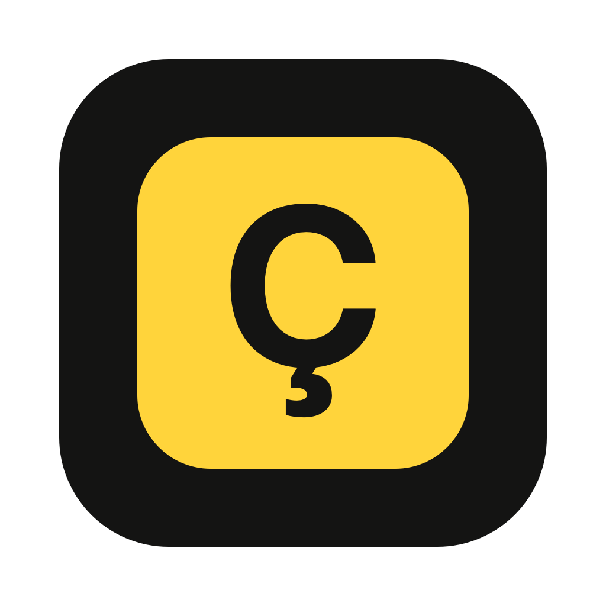

<p align="center"></p>

<h1 align="center">TecTec 🇧🇷</h1>

<p align="center">Som de teclado mecânico no Mac, feito para o teclado ABNT2.<br><em>Mechanical keyboard sounds for macOS, made for the Brazilian ABNT2 layout.</em></p>


Fica na barra de menus e toca um som de switch mecânico a cada tecla.
É uma versão própria, inspirada no funcionamento do [Klack](https://tryklack.com/). Os sons são **gravações reais de 13 switches** do projeto open source [kbsim](https://github.com/tplai/kbsim) (licença MIT, © Thomas Lai; ver `Resources/Switches/LICENSE-kbsim.txt`). Nenhum sample do Klack foi usado.

## Rodar

Precisa do Xcode (ou das Command Line Tools) instalado.

```bash
git clone https://github.com/rafabittt/tectec.git
cd tectec
./build.sh && open TecTec.app
```

1. Um ícone de teclado aparece na barra de menus.
2. O macOS pede a permissão **Monitoramento de Entrada**. Ative o TecTec em
   *Ajustes do Sistema → Privacidade e Segurança → Monitoramento de Entrada*.
3. Se o ícone continuar com "!", use **Reiniciar TecTec** no menu.

> O app é assinado localmente (ad-hoc) com um requisito fixo pelo identificador `br.tectec.app`, então recompilar não derruba a permissão. Se ela sumir mesmo assim, rode `tccutil reset ListenEvent br.tectec.app` e abra o app de novo.

Requer macOS 13 ou mais recente. O binário é universal (Apple Silicon e Intel).

## O que tem

- **13 switches reais**, agrupados por tipo:
  - *Lineares*: NovelKeys Cream, Gateron Black Ink, Gateron Red Ink, Cherry MX Black, Alpaca, Turquoise Tealios
  - *Táteis*: Holy Panda, Cherry MX Brown
  - *Clicky*: Cherry MX Blue, Kailh Box Navy, SKCM Blue Alps
  - *Clássicos especiais*: Buckling Spring (IBM Model M), Topre
- Som de apertar e de soltar gravados separadamente, um por fileira do teclado; Espaço, Enter e Backspace têm gravação própria (menos no MX Blue, que usa a fileira de baixo).
- **Áudio espacial** pelo layout físico ABNT2: Ç, ~, ´ e a tecla /? ficam no lugar certo. Também tem o modo HRTF para fone de ouvido.
- Variação aleatória de tom, volume, opção de ignorar tecla segurada e de abrir ao iniciar o Mac.
- **Pacotes personalizados** em `~/Library/Application Support/TecTec/Pacotes/<Nome>/`:
  - arquivos `<código>-down.wav` e `<código>-up.wav` (códigos uiohook: 30 = A, 57 = espaço, 28 = Enter, 39 = Ç…) com `default-down.wav` opcional; ou
  - pacotes do **Mechvibes** (`config.json`, tipos single e multi). Formatos: wav, mp3, m4a, aiff e caf. O macOS não lê `.ogg`.
- Campos de senha não disparam som, porque o macOS esconde esses eventos (Secure Input).

## Engenharia reversa: o que descobri sobre o Klack

Fontes: o site público (tryklack.com), analisado com o [REA](https://github.com/morluto/rea) (`analyze-javascript-application`) e com leitura do bundle. O app do Mac é pago e não está instalado aqui, então o binário **não** foi analisado.

| Achado | Evidência no JS do site | Como o TecTec faz |
|---|---|---|
| Um sample de *down* e outro de *up* por tecla | `loadBuffer(\`${slug}/${soundKey}-down\`)` e `-up` | `SoundBank` com down/up por keyCode |
| Teclas indexadas por códigos uiohook/scancode | demo: `37`=K, `57`=espaço, `3675`=⌘, `28`=⏎ | tabela `UIOHook.fromMac` (compatível com pacotes) |
| Samples WAV de CDN, tocados com Web Audio | `cdn.tryklack.com/sounds/preview/<switch>/<code>-down.wav` | AVAudioEngine com 24 vozes |
| Prévia digita uma palavra, 250 ms entre teclas e *up* +125 ms | `Fe=250`, `+125` | "Tocar prévia" digita "TECTEC BRASIL" |
| Pitch aleatório, áudio espacial, menubar, app nativo | lista de recursos da página | `rate` aleatório + `AVAudioEnvironmentNode` + `NSStatusItem` |

## Estrutura

```
Sources/TecTec/
  main.swift          menu, preferências, permissão
  KeyMonitor.swift    CGEventTap listen-only (teclas e modificadores)
  SoundEngine.swift   AVAudioEngine, vozes, espacialização, baixa latência
  Switches.swift      catálogo dos switches e montagem do banco de sons
  Layout.swift        layout físico ABNT2 e mapa kVK → uiohook
  CustomPacks.swift   pacotes do usuário / Mechvibes
Resources/Switches/   gravações (kbsim, MIT)
Resources/AppIcon.icns  ícone (gerado por scripts/make-icon.swift)
```

## Licença e créditos

- Código: [MIT](LICENSE).
- Sons dos switches: [kbsim](https://github.com/tplai/kbsim), © Thomas Lai, MIT ([cópia da licença](Resources/Switches/LICENSE-kbsim.txt)).
- Nomes de switches (Cherry MX, Gateron, Kailh, NovelKeys, Topre etc.) são marcas dos seus donos e aparecem só para descrever o som. O TecTec não tem relação com o Klack nem com esses fabricantes.

Contribuições são bem-vindas: novos switches, melhorias no layout ABNT2 e traduções.
